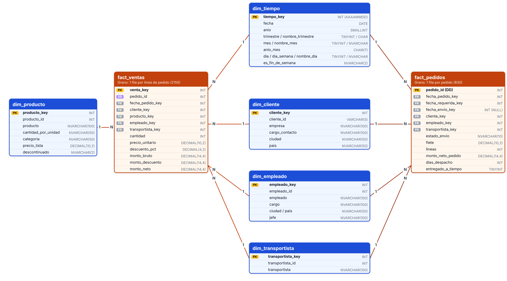

# Modelo Dimensional del Data Warehouse
---

## 1. Tipo de esquema

Se eligió un **esquema estrella**:

- Las dimensiones están **desnormalizadas**: la categoría vive dentro de `dim_producto` y el nombre del jefe dentro de `dim_empleado`. Así se evita unir tablas adicionales.
- Las consultas y las tablas dinámicas de Excel son más simples y rápidas: cada hecho se une directamente con cada dimensión.
- El volumen es pequeño (77 productos, 8 categorías), por lo que la redundancia de repetir la categoría no tiene costo relevante.

El modelo tiene **dos tablas de hechos que comparten las mismas dimensiones** (dimensiones conformadas). Cada tabla de hechos con sus dimensiones forma una estrella. Se usan dos porque hay **dos granularidades distintas** en el negocio .

---

## 2. Diagrama

---

## 3. Granularidad 

| Tabla de hechos | Granularidad | Filas esperadas | Preguntas que responde |
|---|---|---|---|
| `fact_ventas` | **Una fila por línea de pedido** (un producto dentro de un pedido) | 2155 | Ventas por producto, categoría, cliente, país, empleado y período; descuentos |
| `fact_pedidos` | **Una fila por pedido** | 830 | Cumplimiento de entregas, días de despacho, flete, ticket promedio |

**¿Por qué el nivel más detallado en ventas?** Es el nivel atómico de la fuente: permite responder cualquier pregunta por producto, y cualquier nivel superior (pedido, cliente, mes) se obtiene sumando. Agregar los datos de antemano (por ejemplo, ventas por mes) impediría analizar por producto.

**¿Por qué una segunda tabla por pedido?** El flete, las fechas de envío y el cumplimiento de entrega pertenecen al **pedido completo**, no a cada producto. Si se guardaran en `fact_ventas`, un pedido con 5 productos repetiría su flete 5 veces, y al sumar en Excel el flete saldría inflado. Lo mismo pasaría con el porcentaje de entregas a tiempo, que quedaría ponderado por la cantidad de productos y no por pedidos.

---

## 4. Dimensiones 

| Dimensión | Filas | Origen | Atributos para analizar | Transformaciones (ver `02_fuentes_y_calidad_datos.md`) |
|---|---|---|---|---|
| `dim_tiempo` | 1095 (2013-01-01 a 2015-12-31) | Generada en el ETL | año, trimestre, mes, día, día de la semana, fin de semana | Se genera con todos los días del rango, aunque no haya ventas (H8) |
| `dim_cliente` | 91 | `customers` | empresa, cargo del contacto, ciudad, país | Espacios dobles (H4), países estandarizados (H5); incluye clientes sin compras (H9) |
| `dim_producto` | 77 | `products` + `categories` | producto, categoría, presentación, descontinuado | Categoría desnormalizada; descontinuado `Sí`/`No` (H10); espacios dobles (H4) |
| `dim_empleado` | 9 | `employees` (+ sí misma) | empleado, cargo, ciudad, país, jefe | Nombre del jefe resuelto desde `reports_to`; `Sin jefe (Dirección)` si es nulo (H3) |
| `dim_transportista` | 3 | `shippers` | transportista | — |

### Decisiones de diseño

- **Llaves sustitutas** (`cliente_key`, `producto_key`, etc.): enteros autoincrementales propios del DW. Se conserva además la **llave de negocio** de la fuente (`cliente_id`, `producto_id`...) para rastrear cada registro hasta su origen. Así el DW no depende de cómo la fuente numere sus registros.
- **Dimensión de rol (role-playing):** `dim_tiempo` se usa tres veces en `fact_pedidos` (fecha de pedido, requerida y de envío) sin duplicar la tabla.
- **Dimensión degenerada:** `pedido_id` vive en los hechos sin tabla propia, porque el pedido no tiene atributos descriptivos adicionales; sirve para agrupar o contar pedidos.
- **Llave de tiempo `AAAAMMDD`** (ej. `20140315`): es legible y permite filtrar por rangos de fechas directamente en los hechos.
- **Pedidos pendientes:** `fecha_envio_key`, `dias_despacho` y `entregado_a_tiempo` quedan en `NULL` (H2). En Excel, el promedio de `entregado_a_tiempo` ignora los nulos y da directamente el **% de entregas a tiempo** solo de los pedidos enviados.

---

## 5. Medidas 

### `fact_ventas`

| Medida | Cálculo | Tipo | Uso |
|---|---|---|---|
| `cantidad` | `order_details.quantity` | Aditiva | Unidades vendidas |
| `precio_unitario` | `order_details.unit_price` (precio histórico, H6) | No aditiva | Se promedia, no se suma |
| `descuento_pct` | `order_details.discount` | No aditiva | Se promedia, no se suma |
| `monto_bruto` | `precio_unitario × cantidad` | Aditiva | Ventas antes de descuento |
| `monto_descuento` | `monto_bruto × descuento_pct` | Aditiva | Dinero no percibido por descuentos |
| `monto_neto` | `monto_bruto − monto_descuento` | Aditiva | **Ventas netas** (medida principal) |

### `fact_pedidos`

| Medida | Cálculo | Tipo | Uso |
|---|---|---|---|
| `flete` | `orders.freight` | Aditiva | Costo de transporte |
| `lineas` | Cantidad de líneas del pedido | Aditiva | Tamaño del pedido |
| `monto_neto_pedido` | Suma de `monto_neto` de sus líneas | Aditiva | Ticket promedio (promedio de esta medida) |
| `dias_despacho` | `shipped_date − order_date` | Semiaditiva (se promedia) | Velocidad de despacho |
| `entregado_a_tiempo` | 1 si `shipped_date ≤ required_date`, 0 si no | Indicador (se promedia) | % de entregas a tiempo |

Los montos se guardan con 4 decimales para que la suma de las líneas coincida exactamente con el total de control de la fuente (**1 265 793.04**).

---

## 6. Cobertura de las preguntas de negocio

| # | Pregunta (de `01_requisitos_negocio.md`) | Hecho | Medida | Dimensiones |
|---|---|---|---|---|
| 1 | Evolución de las ventas | `fact_ventas` | Suma de `monto_neto` | Tiempo |
| 2 | Categorías y productos que más venden | `fact_ventas` | `monto_neto`, `cantidad` | Producto |
| 3 | Países y clientes más importantes | `fact_ventas` | `monto_neto` | Cliente |
| 4 | Desempeño de los vendedores | `fact_ventas` | `monto_neto`, conteo de `pedido_id` | Empleado |
| 5 | Ticket promedio | `fact_pedidos` | Promedio de `monto_neto_pedido` | Tiempo, Cliente |
| 6 | Dinero no percibido por descuentos | `fact_ventas` | Suma de `monto_descuento` | Producto, Cliente, Tiempo |
| 7 | Cumplimiento de entregas | `fact_pedidos` | Promedio de `entregado_a_tiempo` | Transportista, Tiempo |
| 8 | Transportista más rápido y más caro | `fact_pedidos` | Promedio de `dias_despacho`, `flete` | Transportista |
| 9 | Peso de los productos descontinuados | `fact_ventas` | `monto_neto` | Producto (`descontinuado`) |

