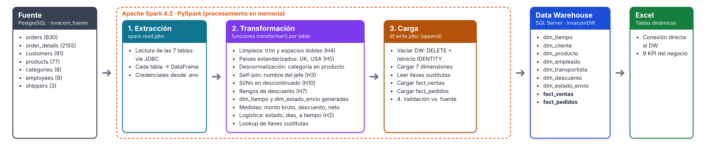

# Diseño del Proceso ETL

**Herramienta:** Apache Spark 4.2 (PySpark) · **Origen:** PostgreSQL (`invacom_fuente`) · **Destino:** SQL Server (`InvacomDW`)

---

## 1. Arquitectura general



```
PostgreSQL ──JDBC──► Spark (memoria) ──JDBC──► SQL Server ──► Excel
 (fuente)            Extraer → Transformar → Cargar   (DW)       (tablas dinámicas)
```

- **Extracción:** Spark lee las 7 tablas de PostgreSQL mediante el driver JDBC y las convierte en DataFrames.
- **Transformación:** se hace **en memoria, dentro de Spark**: limpieza, estandarización, uniones (*joins*), cálculo de medidas y asignación de llaves sustitutas.
- **Carga:** Spark escribe los DataFrames en las tablas del modelo estrella de SQL Server mediante JDBC.

**¿Por qué ETL y no ELT?** La transformación ocurre en Spark, antes de llegar al DW. Así el DW solo recibe datos limpios y la lógica de negocio queda versionada en código Python dentro del repositorio.

---

## 2. Estrategia de carga

| Decisión | Elección | Justificación |
|---|---|---|
| Tipo de carga | **Completa** (*full load*): en cada ejecución se vacía el DW y se recarga todo | El volumen es pequeño (≈ 3 000 filas en total) y la fuente es estática. Es más simple y garantiza que el DW quede idéntico a la fuente |
| Vaciado | `DELETE` en orden inverso (hechos → dimensiones) + reinicio de los contadores `IDENTITY` | `TRUNCATE` no se permite en tablas referenciadas por llaves foráneas |
| Escritura | `mode="append"` sobre tablas ya creadas por `sql/dw/01_crear_modelo_estrella.sql` | Con `overwrite`, Spark borraría y recrearía las tablas, perdiendo las llaves primarias, foráneas y tipos de dato definidos |
| Llaves sustitutas | Las genera SQL Server (`IDENTITY`) al insertar las dimensiones | Después, Spark **vuelve a leer** las dimensiones para obtener el mapa *llave de negocio → llave sustituta* que usan los hechos |
| Credenciales | Archivo `.env` (no se sube al repositorio) | Seguridad: no hay contraseñas en el código |

**Mejora futura:** en un escenario real con datos que cambian a diario se usaría **carga incremental** (solo pedidos nuevos o modificados) y dimensiones de cambio lento (SCD tipo 2).

---

## 3. Orden de ejecución

| # | Etapa | Detalle |
|---|---|---|
| 1 | Conectar | Crear la sesión de Spark y leer la configuración del `.env` |
| 2 | Extraer | Leer las 7 tablas de `invacom_fuente` |
| 3 | Vaciar el DW | `DELETE` de `fact_ventas` y `fact_pedidos`; luego de las 7 dimensiones; reiniciar `IDENTITY` |
| 4 | Transformar y cargar dimensiones | `dim_tiempo`, `dim_cliente`, `dim_producto`, `dim_empleado`, `dim_transportista`, `dim_descuento`, `dim_estado_envio` |
| 5 | Leer llaves sustitutas | Leer de vuelta las 6 dimensiones con `IDENTITY` desde SQL Server |
| 6 | Transformar y cargar `fact_ventas` | Unir `order_details` + `orders` y reemplazar las llaves de negocio por las sustitutas |
| 7 | Transformar y cargar `fact_pedidos` | Agregar por pedido y calcular las medidas de logística |
| 8 | Validar | Comparar conteos y totales contra la fuente (sección 6) |

**Las dimensiones se cargan antes que los hechos** porque los hechos tienen llaves foráneas hacia ellas.

---

## 4. Transformaciones por tabla destino

### 4.1 `dim_tiempo` (generada, no extraída)

| Destino | Regla |
|---|---|
| `fecha` | Secuencia de todos los días entre 2013-01-01 y 2015-12-31 (`sequence` + `explode` en Spark) |
| `tiempo_key` | `AAAAMMDD` → `date_format(fecha, 'yyyyMMdd')` convertido a entero |
| `anio`, `trimestre`, `mes`, `dia` | Funciones `year`, `quarter`, `month`, `dayofmonth` |
| `nombre_trimestre` | `'T' + trimestre` |
| `nombre_mes`, `nombre_dia` | Traducción al español con una tabla de equivalencias (Enero…Diciembre, Lunes…Domingo) |
| `anio_mes` | `date_format(fecha, 'yyyy-MM')` |
| `dia_semana` | 1 = lunes … 7 = domingo |
| `es_fin_de_semana` | `Sí` si es sábado o domingo, `No` en otro caso |

### 4.2 `dim_cliente` ← `customers`

| Destino | Origen | Transformación | Hallazgo |
|---|---|---|---|
| `cliente_id` | `customer_id` | Sin cambios | — |
| `empresa` | `company_name` | `trim` + espacios múltiples → uno | H4 |
| `cargo_contacto` | `contact_title` | `trim` | — |
| `ciudad` | `city` | `trim` | — |
| `pais` | `country` | `UK` → `United Kingdom`, `USA` → `United States` | H5 |

Se cargan los 91 clientes, incluidos los 2 sin compras (H9). `contact_name` se descarta.

### 4.3 `dim_producto` ← `products` + `categories`

| Destino | Origen | Transformación | Hallazgo |
|---|---|---|---|
| `producto_id` | `product_id` | Sin cambios | — |
| `producto` | `product_name` | `trim` + espacios múltiples | H4 |
| `cantidad_por_unidad` | `quantity_per_unit` | `trim` + espacios múltiples | H4 |
| `categoria` | `categories.category_name` | **Join** por `category_id` (desnormalización) | — |
| `precio_lista` | `unit_price` | Sin cambios (atributo descriptivo) | H6 |
| `descontinuado` | `discontinued` | `true` → `Sí`, `false` → `No` | H10 |

### 4.4 `dim_empleado` ← `employees` (unida consigo misma)

| Destino | Origen | Transformación | Hallazgo |
|---|---|---|---|
| `empleado_id`, `empleado`, `cargo`, `ciudad` | columnas homónimas | `trim` | — |
| `pais` | `country` | Misma estandarización de países | H5 |
| `jefe` | `reports_to` | **Self-join**: `employees e LEFT JOIN employees j ON e.reports_to = j.employee_id` → nombre del jefe; si es nulo, `Sin jefe (Dirección)` | H3 |

### 4.5 `dim_transportista` ← `shippers`

| Destino | Origen | Transformación |
|---|---|---|
| `transportista_id` | `shipper_id` | Sin cambios |
| `transportista` | `company_name` | `trim` |

### 4.6 `dim_descuento` ← valores distintos de `order_details.discount`

| Destino | Regla |
|---|---|
| `descuento_pct` | `select distinct discount` de `order_details` (11 valores) |
| `descuento_texto` | Porcentaje legible: `0.15` → `15 %` |
| `rango_descuento` | `0` → `Sin descuento`; `0.01–0.05` → `Bajo (1-5 %)`; `0.06–0.15` → `Medio (6-15 %)`; `0.16–0.25` → `Alto (16-25 %)` |
| `tiene_descuento` | `Sí` si es mayor que 0, si no `No` |

Los descuentos atípicos del pedido 11077 (1 %, 2 %, 3 %, 4 %, 6 %) quedan en los rangos Bajo y Medio (H7).

### 4.7 `dim_estado_envio` (generada, no extraída)

Se generan en Spark las **9 combinaciones posibles**:

| `estado_envio` | `cumplimiento` | `rango_despacho` |
|---|---|---|
| Enviado | A tiempo | 0-7 días · 8-14 días · 15-28 días · Más de 28 días |
| Enviado | Tarde | 0-7 días · 8-14 días · 15-28 días · Más de 28 días |
| Pendiente | Pendiente | Sin enviar |

Se generan todas, aunque hoy algunas no tengan pedidos, para que el DW acepte datos futuros sin cambios.

### 4.8 `fact_ventas` ← `order_details` + `orders` + dimensiones

1. **Join** `order_details` con `orders` por `order_id` (para obtener cliente, empleado, transportista y fecha).
2. Calcular las medidas:
   - `monto_bruto = unit_price × quantity`
   - `monto_descuento = monto_bruto × discount`
   - `monto_neto = monto_bruto − monto_descuento`
3. `fecha_pedido_key` = `order_date` en formato `AAAAMMDD`.
4. **Lookup de llaves sustitutas**: join con `dim_cliente`, `dim_producto`, `dim_empleado`, `dim_transportista` y `dim_descuento` (leídas desde SQL Server) por su llave de negocio (`descuento_pct` en el caso del descuento).
5. Se usa el precio de `order_details`, nunca el de `products` (H6). Los descuentos atípicos se conservan (H7).

### 4.9 `fact_pedidos` ← `orders` + líneas ya calculadas

1. Agrupar las líneas de `fact_ventas` por pedido: `lineas = count(*)`, `monto_neto_pedido = sum(monto_neto)`.
2. Join con `orders` para las fechas y el flete.
3. Calcular las medidas de logística (H2):

| Medida | Regla |
|---|---|
| `fecha_envio_key` | `AAAAMMDD` de `shipped_date`; **NULL** si no tiene fecha |
| `dias_despacho` | `datediff(shipped_date, order_date)`; NULL si está pendiente |
| `entregado_a_tiempo` | 1 si `shipped_date ≤ required_date`, 0 si es posterior, NULL si está pendiente |
| `estado_envio_key` | Se calculan `estado_envio`, `cumplimiento` y `rango_despacho` con las reglas de 4.7 y se busca su llave en `dim_estado_envio` |

4. Lookup de llaves sustitutas de cliente, empleado, transportista y estado de envío.

---

## 5. Estructura del código

```
etl/
├── 00_prueba_conexion.py     # prueba inicial (ya existe)
├── config.py                 # sesión de Spark, conexiones y utilidades de lectura/escritura
├── dim_tiempo.py             # transformación de cada dimensión
├── dim_cliente.py
├── dim_producto.py
├── dim_empleado.py
├── dim_transportista.py
├── dim_descuento.py
├── dim_estado_envio.py
├── fact_ventas.py            # transformación de cada tabla de hechos
├── fact_pedidos.py
├── validacion.py             # conciliación fuente vs. DW
└── main.py                   # orquesta las etapas 1 a 8 en orden
```

Cada archivo de transformación expone una función `transformar(...)` que recibe DataFrames y devuelve un DataFrame listo para cargar. `main.py` es el único que lee, escribe y define el orden. Esto permite que **cada integrante desarrolle y pruebe una dimensión por separado**.

**Ejecución:** `python etl/main.py`

---

## 6. Validación de la carga

Al terminar, `validacion.py` compara el DW contra la fuente y muestra `OK` o `ERROR` en cada control:

| Control | Fuente | DW | Esperado |
|---|---|---|---|
| Clientes | `COUNT(*) customers` | `COUNT(*) dim_cliente` | 91 |
| Productos | `COUNT(*) products` | `COUNT(*) dim_producto` | 77 |
| Empleados | `COUNT(*) employees` | `COUNT(*) dim_empleado` | 9 |
| Transportistas | `COUNT(*) shippers` | `COUNT(*) dim_transportista` | 3 |
| Días | — | `COUNT(*) dim_tiempo` | 1095 |
| Descuentos | `COUNT(DISTINCT discount)` | `COUNT(*) dim_descuento` | 11 |
| Estados de envío | — | `COUNT(*) dim_estado_envio` | 9 |
| Líneas de venta | `COUNT(*) order_details` | `COUNT(*) fact_ventas` | 2155 |
| Pedidos | `COUNT(*) orders` | `COUNT(*) fact_pedidos` | 830 |
| **Ventas netas** | `SUM(unit_price × quantity × (1 − discount))` | `SUM(monto_neto)` | **1 265 793.04** |
| Flete total | `SUM(freight)` | `SUM(flete)` | iguales |
| Pedidos pendientes | `shipped_date IS NULL` | pedidos con `estado_envio = 'Pendiente'` | 21 |
| Pedidos tarde | `shipped_date > required_date` | `entregado_a_tiempo = 0` | 37 |

Si un control falla, el proceso lo informa y el equipo revisa la transformación correspondiente antes de usar los reportes.
